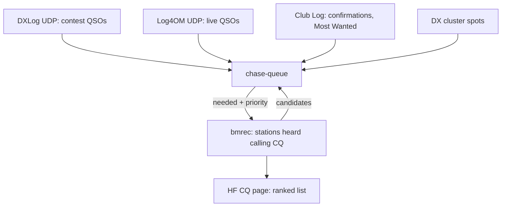

# Chase Queue v1 - Plan

## Goal Capsule

- **Objective:** The operator works more needed stations that nobody has spotted (contest multipliers and unworked contest stations; DXCC entities not yet confirmed on the band) from one ranked list on bmrec's HF CQ page, without reviewing stations that are already spotted or already worked.
- **Means:** chase-queue, a stationa component on the station MQTT bus (slot `muehle/hf/chase`, runs on scmino), decides whether a station is needed and how much; bmrec hears the stations and shows the list.
- **Product authority:** the operator (repository owner). This plan covers chase-queue's first version and the bmrec list that consumes it; the areas under "How This Work Fits Together" are not active scope.
- **Open blockers:** none.

---

## Product Contract

### Summary

chase-queue answers, for every station bmrec hears calling CQ, whether it is needed and with which priority, for contests (from bmrec's existing contest engine, moved into chase-queue) and for DX chasing (DXCC entity not confirmed on the band). bmrec's HF CQ page replaces both the CQ board and the contest card with one live-ranked list that the operator works by selecting a row.

### Problem Frame

The operator chases DX mostly from the DX cluster and tunes the band by hand only in laid-back moments, so stations calling CQ that nobody has spotted go unworked, including rare ones. bmrec already hears those stations, but its CQ board lists everything it hears with no priority. Contest mode added a priority queue, presented as one pinned card with the queue below; in use the card did not hold up, and listening to a card kept a station on screen after it was spotted, which contradicts the brief: "I don't want to review potential calls that have been spotted already. I don't want to review potential calls that I have worked already."

The ranking logic also does not belong in bmrec. Deciding what is needed depends on the operator's log, awards and contest rules, which will grow beyond DXCC and beyond bmrec's own list (other views, cluster spots, other activities). Keeping it in the recorder would tie every future award rule to a program whose job is hearing stations.

### Key Decisions

- **Ranking moves out of bmrec into chase-queue, a stationa component that follows the station integration model (MQTT slots).** bmrec publishes its candidates and reads the ranking; it does not compute needed or priority itself. Governs R1, R2, R3. (session-settled: user-directed — chosen over a separate chase-queue repository with an HTTP API, and over a binary inside horstreporter or bmrec: the queue is to be reusable by several consumers and activities, and stationa already owns the station bus.)
- **chase-queue starts from bmrec's contest engine.** Its tiers, multiplier value, DXLog feed, Club Log Most Wanted ranks and cty lookup move into chase-queue. Governs R4, R5. (session-settled: user-directed — chosen over starting from horstreporter's award engine, from both, or from an empty skeleton.)
- **A list, not a pinned card.** Governs R10. (session-settled: user-directed — chosen over the pinned card with a queue below: the card did not hold up in use.)
- **Select, then act.** Governs R11. (session-settled: user-directed — chosen over buttons on every row.)
- **The list re-ranks live; only the open row holds its place.** Governs R12, R13. (session-settled: user-directed — chosen over re-ranking only after an action, and over never moving existing rows; the open row staying put was chosen over moving it with its rank.)
- **Spotted and worked stations leave at once, even while open.** Governs R6, R7, R14. (session-settled: user-directed — chosen over keeping an open card with an "On the cluster" tag, which the user rejected as contradicting the brief.)
- **DX mode lists stations heard and not on the cluster.** Governs R6. (session-settled: user-directed — chosen over everything bmrec hears, and over adding all cluster spots; the cluster-spot chase queue is a later, separate component.)
- **DX v1 has one criterion: DXCC entity not confirmed on the band.** Governs R8. (session-settled: user-directed — chosen over an ordered, configurable goal list with buddies, Most Wanted cut-off and mode slots, and over entity-only: award chasing is to move into its own module later, so v1 is an MVP.)
- **Needed until confirmed, not until worked.** Governs R8, R9. (session-settled: user-directed — chosen over "once worked" and over "worked ranks lower".)
- **History v1: Club Log confirmations, Log4OM live QSOs, DXLog in contests; no LoTW.** Governs R5, R9. (session-settled: user-directed — LoTW was dropped as too complex for v1; Log4OM was chosen as the everyday logger over N1MM, DXLog or no live feed.)
- **Stations that are not needed stay on the list, below the needed ones.** Governs R15. (session-settled: user-directed — chosen over hiding them, with or without a count.)
- **DX mode has the same actions as contest mode: Spot, QSY, Skip.** Governs R11. (session-settled: user-directed — chosen over a QSY-first variant that spots only to the local node, and over no spotting.)
- **DX order among needed stations follows the contest rule: more new slots first, rarer first.** Governs R8.
- **One small tag marks a needed row, never the reason.** Governs R16. The operator decided earlier that ordering criteria (which multiplier, Most Wanted rank) are not something to read.

### Requirements

**chase-queue: needed and priority**

- R1. chase-queue runs as its own executable and answers, for a station heard by bmrec (callsign or a candidate without one, band, frequency, time), whether it is needed and its priority within the active activity.
- R2. bmrec's list order comes only from chase-queue's answers; bmrec keeps no award or contest rules of its own.
- R3. The active activity is contest when contest mode is on and DX chasing when it is off; chase-queue applies that activity's rules.
- R4. In contest mode chase-queue ranks exactly as bmrec's contest engine does today: new multipliers first (more new slots, then Club Log Most Wanted rank, then district or zone multipliers, then oldest), then stations whose value is unknown, then unworked stations, then candidates without a callsign.
- R5. In contest mode chase-queue takes worked QSOs from DXLog's UDP feed, and the contest definition, prefill and instances (start, resume, delete) move with the engine.
- R6. A station already spotted on the cluster (same station, same band, within 30 minutes) is not on the list, in either mode.
- R7. A station already worked is not on the list: in a contest, worked in this contest on this band; in DX mode, worked on this band according to Log4OM or Club Log.
- R8. In DX mode a station is needed when its DXCC entity is not confirmed on the band it is heard on; among needed stations, an entity never confirmed on any band ranks before one new only on this band, and Club Log Most Wanted rank orders within each.
- R9. chase-queue knows confirmations from the operator's Club Log log and live QSOs from Log4OM's UDP feed; a QSO reported by Log4OM counts as worked at once and as confirmed only once Club Log shows it.

**bmrec: the list**

- R10. bmrec's HF CQ page shows one list in both modes, replacing the CQ board, its nets toggle and maybe-CQ section, and the contest card.
- R11. Arrow keys or a click select a row, which opens in place with the editable callsign, the latest clip, Live, the spot comment and Spot, QSY and Skip; every other row is one line (callsign or "no call", frequency, tag).
- R12. The list re-ranks live as chase-queue's answers and the heard stations change.
- R13. While a row is open it keeps its place on screen and the other rows re-rank around it; it takes its ranked place once the operator acts or closes it.
- R14. When the open station leaves the list (spotted, worked, its row closed), the row closes and the selection moves to the top row.
- R15. Stations that are not needed are listed below all needed stations.
- R16. A needed row carries one small tag, "mult" in contests and "need" in DX mode; the list shows no multiplier name, rank, sideband or other ordering criteria.
- R17. Skip and Undo keep their current contest behavior and apply in DX mode too.
- R18. When chase-queue cannot be reached, the list still shows the stations bmrec hears, unranked, with one problem line saying so.

**Data and privacy**

- R19. Club Log credentials and the operator's log stay with chase-queue, and no API returns the credentials.

### Key Flows

- F1. Working a needed DX station
  - **Trigger:** bmrec hears a station calling CQ that is not on the cluster.
  - **Steps:** chase-queue answers needed with a priority; the row appears in ranked place with "need"; the operator selects it, listens to the clip or Live, corrects the callsign if needed, then QSYs (or spots) and works it; Log4OM reports the QSO and the station leaves the list.
  - **Covered by:** R1, R8, R9, R11, R12, R16
- F2. Working a contest
  - **Trigger:** contest mode is on with a contest instance active.
  - **Steps:** chase-queue ranks by multiplier value and DXLog QSOs; the operator works from the top, using Spot, QSY or Skip on the selected row; spotted and worked stations drop out as they happen.
  - **Covered by:** R3, R4, R5, R6, R7, R11
- F3. The open station leaves
  - **Trigger:** the station the operator has open gets spotted or worked, or its row closes.
  - **Steps:** the row disappears without a tag; the selection moves to the top row.
  - **Covered by:** R6, R7, R14

### Acceptance Examples

- AE1. **Covers R7, R9.** Given an entity not confirmed on 20m, when Log4OM reports a QSO with EA8XYZ on 20m, then EA8XYZ leaves the list at once, and EA8ABC from the same entity heard on 20m still shows "need" until Club Log shows the 20m confirmation.
- AE2. **Covers R8.** Given entity A never confirmed on any band and entity B confirmed only on 40m, when stations from both are heard on 20m, then the station from A ranks above the station from B, and both rank above stations that are not needed.
- AE3. **Covers R13.** Given the operator has the third row open and is typing a callsign, when a new needed station arrives that outranks it, then the open row stays where it is on screen and the new station takes its place among the other rows.
- AE4. **Covers R14.** Given the operator has a row open, when that station is spotted on the cluster on the same band, then the row disappears and the top row is selected.
- AE5. **Covers R15.** Given a station whose entity is confirmed on the band it is heard on, when it calls CQ unspotted, then it is listed below every needed station, without a tag.
- AE6. **Covers R18.** Given chase-queue is not running, when bmrec hears stations calling CQ, then the list shows them unranked with one problem line naming chase-queue.
- AE7. **Covers R6.** Given a contest, when a station on the list is spotted on the cluster on the same band, then it leaves the list, and it does not come back while the spot is younger than 30 minutes.

### Success Criteria

- The operator reviews no spotted and no already-worked stations in either mode.
- During a contest and a DX session, the operator works stations from the list that never appeared on the cluster, including needed ones (new multipliers, DXCC entities new on a band).

### Scope Boundaries

- No LoTW, paper-QSL or eQSL source of its own in v1; such confirmations count once they reach Club Log.
- No award criteria beyond DXCC entity per band in v1: no mode slots, buddies, Most Wanted cut-off, WAS or user-configurable goal list.
- No POTA, now or later: activators spot themselves.
- No modes other than SSB; bmrec hears only SSB.
- No chase-queue view of cluster spots in v1, and no visualization other than bmrec's list.

<!-- ce-section: work-relationships -->
### How This Work Fits Together

This plan covers chase-queue v1 and the bmrec list that consumes it. The areas below are the current understanding, not a committed roadmap.

- A chase-queue view that merges DX-cluster spots with bmrec candidates into one ordered queue, shown as a horstreporter module or as chase-queue's own app. Depends on this plan's needed/priority answer. Still to decide which view comes first.
- Award chasing beyond DXCC (mode, buddies, Most Wanted cut-off, LoTW). Depends on this plan's chase-queue history; extends R8.
- horstreporter's existing Chase Queue and award engine (`internal/awards`, Wavelog as log source). Shares the purpose of chase-queue. Still to decide whether chase-queue replaces it, uses it, or is used by it.
- Further activities beyond contests and DX chasing. Depends on R3's activity switch.

### Dependencies / Assumptions

- The operator's Club Log log holds their confirmations (LoTW matches synced to Club Log); entities confirmed elsewhere but not in Club Log show as needed.
- Log4OM 2 is configured to send each logged QSO over UDP to chase-queue.
- bmrec and chase-queue share the station broker on scmino; the cluster spots reach chase-queue through bmrec's retained candidates.
- The contest setup (definition upload, start, resume, delete) stays reachable from bmrec's HF CQ page, as today.

### Outstanding Questions

**Deferred to Planning**

- Club Log's matrix status values for "confirmed" are undocumented; verify them against the Club Log web chart with `-clublog-probe` before trusting DX ranking.
- Downloading the Club Log log (callsigns worked, as opposed to entity confirmations) is not built yet; worked callsigns come from Log4OM until it is.
- DXLog's broadcast needs a second target port, because logger-spot-bridge already binds UDP 12060 on scmino.

### Sources / Research

- bmrec contest engine to move: `bmrec:internal/contest` (queue.go tiers and ordering, engine.go hiding and the 30-minute spot horizon, value.go, definition.go, prefill.go), with `bmrec:internal/hf/cty`, `bmrec:internal/clublog/mostwanted.go` and `bmrec:internal/dxlog`.
- bmrec list today: `bmrec:web/src/HFCQ.svelte`, `bmrec:web/src/lib/ContestCard.svelte`; behavior described in bmrec's README "Contest mode (multiplier queue)".
- Earlier contest plan: `bmrec:docs/plans/2026-11-01-1642-feat-contest-mult-queue-plan.md` (on branch claude/contest-mult-queue; its hold, banner and announcement parts were removed in use).
- horstreporter Chase Queue: `horstreporter:CONCEPTS.md` (Chase Queue, Award slot), `horstreporter:internal/awardcontract`.
