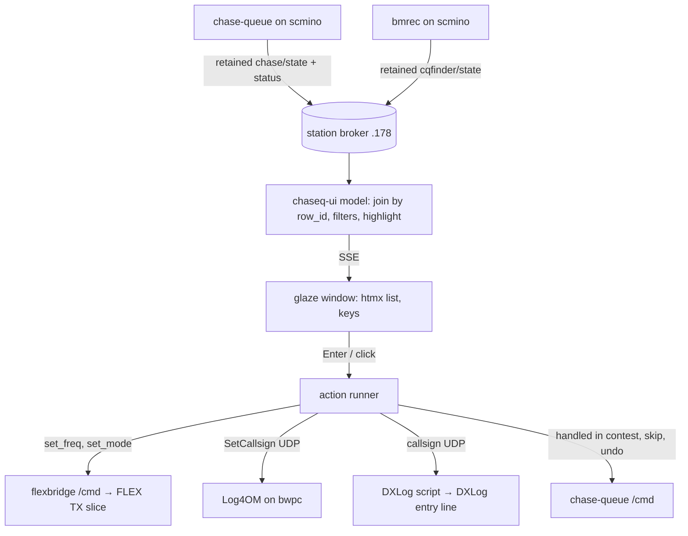

# chaseq-ui - Plan

> **Note (2026-11-03):** the domain roles are set in `../chasing-stations-architecture.md`. The MQTT password lives in `config.toml` only (05fc96b); the env var in KTD9 and U2 is gone.

## Goal Capsule

- **Objective:** At the logging PC, the operator gets from chase-queue's ranked list onto a station in one keystroke: the radio is tuned to it and its callsign is waiting in the logger, with no retuning or typing by hand.
- **Means:** chaseq-ui, a new stationa component: a native desktop window on bwpc built like qslotter, a consumer of `muehle/hf/chase` and a `/cmd` sender, not a slot (KTD1, KTD2).
- **Product authority:** the operator (repository owner). chase-queue's ranking, criteria and activities are not in scope; chaseq-ui only shows and acts on them.
- **Execution profile:** one branch cut from current `main` (it must contain `chase-queue/`; this worktree's base `b7fd225` does not), merged straight to `main` (stationa has no CI and lands work by merging, not by PR). U1 touches flexbridge; U7 also edits `stationportal/internal/inventory/inventory.toml`, root `CLAUDE.md` and `docs/conventions/mqtt-topology.md`; the other units create `chaseq-ui/`.
- **Stop conditions:** stop and ask if the DXLog script (U5) cannot fill DXLog's callsign field live, before building the keystroke fallback; stop before any deploy (flexbridge on scmino, chaseq-ui on bwpc, portal) until the operator says so.
- **Who finishes:** the implementer builds and tests; the operator approves each deploy, installs the DXLog script once, and confirms the live checks in the Verification Contract.
- **Open blockers:** none.

---

## Product Contract

Product Contract preservation: restructured, no scope change. The brainstorm's Deferred-to-Planning questions are resolved in place by KTD3–KTD6; Dependencies / Assumptions now carry the research results.

### Summary

chaseq-ui is a small native window on the shack PC (bwpc) that shows chase-queue's live ranked list in chase-queue's order, with local view filters on top. Arrow keys move a highlight. Click or Enter tunes the radio to the station and puts its callsign into Log4OM and DXLog. Skip and Undo go to chase-queue, so bmrec's HF CQ page and this window always show the same list.

### Problem Frame

chase-queue (slot `muehle/hf/chase`, on scmino) already decides which of the unspotted stations bmrec hears are needed and in what order, in DX and contest mode. Its only view is bmrec's HF CQ page in a browser. The loggers, Log4OM for everyday DX and DXLog in contests, run on bwpc. Working a station from the queue therefore means reading it in one place, retuning the radio and typing the callsign into the logger by hand. During a contest or a quick DX moment, that friction is exactly what makes unspotted needed stations go unworked.

### Key Decisions

- **chase-queue owns all ranking and criteria; chaseq-ui adds view filters only.** Governs R1, R2, R5. (session-settled: user-directed — chosen over chaseq-ui setting award goals, switching activity or adding cluster spots: chase-queue's scope is to provide everything the view needs.)
- **Arrow keys only move the highlight; click or Enter acts.** Governs R7, R8. (session-settled: user-directed — chosen over acting on every selection change, which sweeps the radio across the band while browsing, and over bmrec-style select-then-buttons.)
- **The callsign goes to both Log4OM and DXLog every time.** Governs R9. (session-settled: user-directed — chosen over picking the logger by activity and over a logger setting in the app.)
- **Skip and Undo are the only chase-queue actions in chaseq-ui.** Governs R11. (session-settled: user-directed — chosen over adding Spot, over adding contest setup and the DX/contest switch, and over no actions.)
- **A native window on bwpc with qslotter's stack.** The loggers run on bwpc, so filling their callsign stays a local action. Governs R13. (session-settled: user-approved — proposed over a page served from scmino, which would still need something local on bwpc to reach the loggers; confirmed in the scoping synthesis.)
- **The radio is tuned over the station bus, not through a logger's rig control.** QSY then works whichever logger is open, with one writer per keypress (KTD3). Governs R8.
- **In a contest, QSY marks the station handled, as bmrec does.** The two views stay consistent. Governs R10.

### Requirements

**The list**

- R1. chaseq-ui shows chase-queue's ranked stations in chase-queue's order, one row each: callsign (or "no call"), band, frequency and the `need`/`mult` tag.
- R2. The list follows chase-queue live: rows appear, leave and re-rank as chase-queue republishes, without a refresh.
- R3. The highlight stays on its station while the list re-ranks; when that station leaves the list, the highlight moves to the top row.
- R4. chase-queue's problem lines are shown above the list, and when chase-queue is offline or its state is stale, one line says so and actions are disabled.
- R5. View filters narrow what is shown, at least by band and "needed only"; they live on bwpc, survive a restart, and never change chase-queue's ranking.
- R6. The current activity (DX, or contest with its name) is shown read-only.

**Acting on a station**

- R7. Arrow keys move the highlight without tuning the radio or touching the loggers.
- R8. Click or Enter on a row tunes the radio to that station's frequency.
- R9. The same action puts the row's callsign into the callsign field of Log4OM and of DXLog; a logger that is not running is skipped without blocking the other, and a row with no callsign fills nothing.
- R10. In contest activity, the action also marks the station handled in chase-queue, so it leaves the list in every view; in DX activity the station stays listed.
- R11. Skip hides the highlighted station and Undo reverses the last Skip or handled mark, both through chase-queue with its existing rules; both work from the keyboard.
- R12. When an action fails (radio, a logger, or chase-queue), the window says which part failed; the other parts still complete.

**Packaging**

- R13. chaseq-ui is a single binary with its own window on bwpc, starts at logon like qslotter, and keeps broker credentials out of the command line, logs and UI.
- R14. The station portal inventory lists chaseq-ui like the other components.

### Key Flows

- F1. Working a needed DX station
  - **Trigger:** a station tagged `need` is on the list.
  - **Steps:** the operator arrows to it and presses Enter; the radio tunes to it and both loggers show its callsign; the operator works it; Log4OM reports the QSO to chase-queue and the station leaves the list.
  - **Covered by:** R1, R7, R8, R9
- F2. Working a contest
  - **Trigger:** contest activity is running.
  - **Steps:** the operator presses Enter on the top row; the radio tunes, both loggers get the callsign, and chase-queue marks it handled so it leaves the list; the highlight moves to the new top row.
  - **Covered by:** R3, R8, R9, R10
- F3. Not interested
  - **Trigger:** the highlighted station is not worth working now.
  - **Steps:** the operator presses Skip; it leaves the list here and in bmrec; Undo brings it back.
  - **Covered by:** R11

### Acceptance Examples

- AE1. **Covers R7.** Given the highlight is on row 1, when the operator presses the down arrow three times, then the highlight is on row 4 and the radio frequency and both logger callsign fields are unchanged.
- AE2. **Covers R9.** Given Log4OM is running and DXLog is not, when the operator presses Enter on EA8XYZ, then Log4OM shows EA8XYZ, the radio is on EA8XYZ's frequency, and the window reports DXLog as not reached.
- AE3. **Covers R9.** Given a row without a callsign, when the operator presses Enter, then the radio tunes to it and neither logger's callsign field changes.
- AE4. **Covers R10.** Given contest activity, when the operator presses Enter on DL1ABC, then DL1ABC leaves the list in chaseq-ui and on bmrec's HF CQ page; given DX activity, the same action leaves the station listed.
- AE5. **Covers R3.** Given the highlight is on EA8XYZ in row 3, when a station that outranks it arrives, then EA8XYZ moves to row 4 and keeps the highlight; when EA8XYZ is then spotted on the cluster, the highlight moves to row 1.
- AE6. **Covers R4.** Given chase-queue is offline, when the operator opens chaseq-ui, then one line says chase-queue is offline and Enter, Skip and Undo do nothing.
- AE7. **Covers R5.** Given the filter "20m, needed only", then only needed 20m stations are shown, and bmrec's list is unchanged.

### Scope Boundaries

- No ranking, award criteria, goals or activity rules in chaseq-ui; changes to what counts as needed belong in chase-queue.
- No DX/contest switch, contest setup, spotting or callsign editing; those stay in bmrec or the logger.
- No cluster-spot stations beyond what chase-queue lists.
- No audio (clips, Live); bmrec keeps that.
- No other platform than bwpc for v1.
- Not built: a tray icon, a `/meta`/`/status` slot of chaseq-ui's own, retry of a failed logger send. A failed send is reported (R12) and the operator presses Enter again; evidence of frequent silent drops would change this.
- Not built: overriding a callsign the operator already typed into Log4OM (Log4OM discards `SetCallsign` then, by design).

#### Deferred to Follow-Up Work

- bmrec reads chase-queue's `/state.undo` as an object `{op, call}` (`bmrec:web/src/lib/chase.test.js`), while chase-queue publishes a string (`chase-queue/internal/bus/bus.go`). chaseq-ui follows `bus.go`; fixing bmrec is a separate change in the bmrec repo.
- Moving the rest of the stationa workspace to Go 1.27 (KTD2) so chaseq-ui can join `go.work`.

### Dependencies / Assumptions

- chase-queue (`chase-queue/`, `chase-queue/docs/chase-queue-mqtt-api.md`) is the only source of the list; its `/cmd` `skip`, `handled` and `undo` are used as specified there.
- chase-queue's ranked rows for heard stations carry no frequency; it lives in bmrec's retained `muehle/hf/cqfinder/state` rows (`freq_hz`, float64) under the same `row_id`. Ranked rows from chase-queue's own DX-cluster ingest (`source: "cluster"`, negative `row_id`, no bmrec row) carry `spot.freq_hz` (int Hz) themselves.
- bwpc reaches the scmino station broker `192.168.1.178:1883` (account `hf`), which mirrors `muehle/#` with `.50`.
- Log4OM 2's Remote Control Interface v1.1 accepts `SetCallsign` on its inbound UDP port (2241 by the forum default; horstreporter assumed 2236, so the port is read off Log4OM's settings).
- DXLog.net has no documented inbound callsign interface; a DXLog C# script can listen on loopback and fill the entry field on DXLog's UI thread (unproven until U5's live check).
- DXLog follows a frequency change made through the Flex API on its next CAT poll. DXLog's "Auto Switch TX slice" stays off.

### Sources / Research

- chase-queue contract and rules: `chase-queue/CLAUDE.md`, `chase-queue/docs/chase-queue-mqtt-api.md`, `chase-queue/internal/bus/bus.go`; `handled` defaults `how` to `qsy` over MQTT (`chase-queue/internal/app/mqtt.go`).
- chase-queue v1 plan, which names "chase-queue's own app" as a later view: `docs/plans/2026-11-01-2252-feat-chase-queue-v1-plan.md`.
- bmrec's chase client and QSY order (tune first, then `handled` in contest only): `bmrec:internal/chase/chase.go`, `bmrec:web/src/HFCQ.svelte` (branch `claude/contest-mult-queue`).
- Log4OM Remote Control Interface v1.1 (`SetCallsign`, `SetTxFrequeny`, replies on port+1); existing Go client `horstreporter:cmd/horstoperator-agent/rig_log4om.go`.
- DXLog.net scripting: `main.CurrentNewEntryLine`, `txtCallSign`, `main.Invoke`; inbound UDP only knows `<radio_setfrequency>`.

---

## Planning Contract

### Key Technical Decisions

- KTD1. **chaseq-ui copies qslotter's desktop shape.** A Go binary serves htmx pages and an SSE stream on a loopback port; a glaze WebView window loads that URL (never glaze's `app://` scheme, which buffers SSE). Pages and static files are embedded. Governs R13 via the Key Decision on qslotter's stack. Pattern: `qslotter:internal/desktop/desktop.go`, `qslotter:internal/web/server.go`, `qslotter:internal/events/events.go`, `qslotter:internal/web/static/keys.js`.
- KTD2. **chaseq-ui is its own Go module outside `go.work`.** glaze v0.0.67 and crgimenes/native need Go 1.27.1; all 22 workspace modules and `go.work` are on 1.26.5, and a workspace refuses a member newer than its go line. The module still uses `shared/` through `replace … => ../shared`, and every `go` command in `chaseq-ui/` runs with `GOWORK=off`, as `hf_console/webbridge` builds (`docs/conventions/deployment.md`). Chosen over raising the whole workspace's Go line, which would change every module's build for one window.
- KTD3. **QSY is a new flexbridge `/cmd` action `set_freq`, value `"<Hz>"`, on the receive slice CAT calls VFO A.** It resolves the slice with `rxInputSlice` (slice A while split, the TX slice otherwise) and sends `slice tune <idx> <MHz>`, so the loggers follow the tune in split too. chaseq-ui then sends `set_mode` with the band's sideband from bmrec's band table (`bmrec:internal/hf/bands.go`: LSB on 160/80/40 m, USB on 60 m and 20 m up); while radio `/state.split` is true it sends no `set_mode`, because that action targets the TX slice. No Log4OM `SetTxFrequeny`: one tuning writer per keypress. Chosen over bmrec's `PUT /api/hf/tx-tune`, which would tie chaseq-ui to bmrec's HTTP on scmino.
- KTD4. **Frequency comes from the row's `spot.freq_hz` for cluster rows, else from joining `cqfinder/state` rows to `chase/state` ranked rows by `row_id`.** chaseq-ui subscribes to both retained topics and rounds `freq_hz` to integer Hz. A heard row without a cqfinder row is listed with no frequency, shown as not tunable, and cannot be tuned. Chosen over adding the frequency to chase-queue's `/state`, which would change its contract for a fact bmrec already publishes.
- KTD5. **Log4OM gets `SetCallsign` over its Remote Control UDP.** One `<RemoteControlRequest>` with a fresh MessageId; the reply on port+1 is read with a short timeout. A `Done=False` is a failure, no reply is "sent, not confirmed". The client is a new small package modelled on `horstreporter:cmd/horstoperator-agent/rig_log4om.go`, not imported from it.
- KTD6. **DXLog gets the callsign from a DXLog C# script that chaseq-ui ships.** The script opens a loopback UDP listener in `Initialize`, and on a datagram carrying a callsign sets the entry line's call on DXLog's UI thread (`main.Invoke`). chaseq-ui sends a one-line plain-text datagram. The operator installs the script into DXLog's scripts folder once. Fallback, only if the live check fails: the script focuses `txtCallSign` and sends keystrokes from inside DXLog. Chosen over a cluster-spot feed, which needs a manual double-click.
- KTD7. **Actions run in a fixed order, the callsign waits for the tune, and each part is confirmed from the bus.** Order per Enter: tune (`set_freq`, then `set_mode`), wait until radio `/state.freq_hz` (or `rx_freq_hz` in split) is within 50 Hz of the target or 2 s pass, then Log4OM, DXLog, then `handled` in contest. Waiting keeps the loggers' band, dupe and worked-before checks on the new band and stops a logger that clears its entry line on QSY from erasing the call. The radio part is confirmed by that state, `handled`/Skip/Undo by the next chase `/state` within 5 s (the row gone, or back for Undo); otherwise the part is "not confirmed". Both `/cmd` paths are fire-and-forget, so this is the only way R12 can see a refused command. A failed part does not stop the next. Publishes go through `shared/mqtt.Enqueue`/`RunJobs`, never from a paho handler.
- KTD8. **"Offline or stale" means `muehle/hf/chase/status` is `offline`, or no `/state` within 75 s.** chase-queue republishes every 30 s, so 75 s is two missed heartbeats plus margin. Governs R4.
- KTD9. **Configuration and deploy follow winpc-power-bridge.** TOML `config.toml` next to the exe in `C:\Users\iotte\chaseq-ui\` (ports, broker, Log4OM and DXLog targets, filters file); password in `config.toml` `[mqtt] password` (no environment variable, as qslotter; 05fc96b); log file next to the config with 5 MB rotation, because a `-H=windowsgui` exe has no stderr. Filters persist in a small JSON file next to the config, not in TOML (seed-once config stays operator-owned). Deploy registers an at-logon scheduled task from XML (winpc) and adds qslotter's clean quit, SHA-256 check and health poll.

### High-Level Technical Design



The model is pure: it takes the latest chase state, cqfinder rows, status and filters and returns the rows to show. The highlight is held by `row_id` so a re-rank moves the row, not the highlight (R3).

### Risks

- DXLog script cannot set the call (KTD6): the stop condition in the Goal Capsule applies; the fallback is keystrokes from inside DXLog.
- DXLog in SO2V or with "Auto Switch TX slice" on fights the bus tune: documented in `chaseq-ui/README.md` as required DXLog settings; not guarded in code, because the operator sees the radio jump at once.
- `set_freq` is an additive flexbridge `/cmd` action: existing consumers (hf_console, m5dualkey, beamsteer) send other actions and are unaffected.
- Log4OM's remote-control port differs from the default: the port is a config value and the Log4OM part reports "sent, not confirmed" rather than failing silently.

### Assumptions

- `slice tune` from flexbridge's non-GUI connection is accepted by the FLEX-8400 (bmrec's "Invalid slice receiver" came from a GUI client; flexbridge's `select_rx` works live). Checked live in U1's verification.
- A loopback port above 8473 is free on bwpc (qslotter :8473, Log4OM ADIF :1273, OscarWatch :7373 are taken).

---

## Output Structure

```text
chaseq-ui/
  CLAUDE.md
  README.md
  config.example.toml
  deploy.sh
  go.mod
  cmd/chaseq-ui/main.go
  internal/config/        config + env override
  internal/model/         join, filters, highlight, staleness (pure)
  internal/bus/           MQTT session, subscriptions, /cmd publishing
  internal/action/        the Enter/Skip/Undo runner
  internal/loggers/       log4om.go, dxlog.go
  internal/web/           server, SSE, embedded pages + static
  internal/desktop/       glaze window
  dxlog/ChaseqCallsign.cs DXLog script
  winres/                 icon + manifest
```

---

## Implementation Units

### U1. flexbridge `set_freq` action

**Goal:** flexbridge tunes the TX slice to a frequency from `/cmd`.

**Requirements:** R8; KTD3.

**Dependencies:** none.

**Files:**
- `flexbridge/internal/bridge/bridge.go`
- `flexbridge/internal/flexradio/client.go` (Commander, if a tune method is needed)
- `flexbridge/internal/bridge/bridge_test.go`
- `flexbridge/docs/radio2mqtt-schema.md`
- `flexbridge/CLAUDE.md`

**Approach:**
1. Add `set_freq` beside `set_mode` in the `/cmd` dispatch; parse `value` as integer Hz, reject non-positive or out-of-band-plan nonsense (below 1.8 MHz or above 54 MHz) with a Warn log.
2. Resolve the slice with `rxInputSlice` (KTD3) and send `slice tune <idx> <MHz>` with 6 decimals.
3. Document the action in the schema `/cmd` table and note that the result shows on `/state.freq_hz`.

**Patterns to follow:** the `set_mode` case and `rxInputSlice` in `flexbridge/internal/bridge/bridge.go`; `bmrec:internal/flexradio/live.go` for the `slice tune` wire form.

**Test scenarios:**
- `set_freq` `"14231500"` with TX on slice 0 sends `slice tune 0 14.231500`.
- Not split, TX on slice 1: the tune goes to slice 1.
- Split with TX on slice 1: the tune goes to slice A (0).
- `"abc"`, `"0"` and `"-5"` send nothing.
- `"60000000"` sends nothing.
- No slice known yet: nothing is sent, no panic.

**Verification:** unit tests pass; after an operator-approved flexbridge deploy on scmino, publishing `set_freq` moves the FLEX and `/state.freq_hz` follows.

### U2. chaseq-ui module, config and bus session

**Goal:** a building module that connects to the broker and holds the latest chase state, cqfinder rows and chase status.

**Requirements:** R2, R13; KTD2, KTD8, KTD9.

**Dependencies:** none (U1 only for live QSY).

**Files:**
- `chaseq-ui/go.mod`, `chaseq-ui/cmd/chaseq-ui/main.go`
- `chaseq-ui/internal/config/config.go`, `chaseq-ui/internal/config/config_test.go`
- `chaseq-ui/internal/bus/bus.go`, `chaseq-ui/internal/bus/bus_test.go`
- `chaseq-ui/config.example.toml`

**Approach:**
1. Module `codeberg.org/kgbvax/stationa/chaseq-ui`, `go 1.27.1`, `replace codeberg.org/kgbvax/stationa/shared => ../shared`; not added to `go.work` (KTD2).
2. Config: broker, user, client ID `muehle-chaseq-ui`, site/slot prefixes, HTTP listen, Log4OM target, DXLog script target, log file, filters file; password from `config.toml`.
3. Bus: subscribe `muehle/hf/chase/state`, `/status`, `muehle/hf/cqfinder/state` and `muehle/hf/radio/state` (frequency and split, for KTD3/KTD7); decode into local wire types mirroring `chase-queue/internal/bus/bus.go` (copied, not imported: `internal/` visibility); hand each message to the model through a channel, never doing work in the paho handler.
4. Publishing helpers for `muehle/hf/radio/cmd` and `muehle/hf/chase/cmd` through `shared/mqtt` jobs.

**Patterns to follow:** `winpc-power-bridge/cmd/winpc-power-bridge/main.go` (session, `sharedmqtt.Connect`, `RunJobs`, retry); `testui/internal/config/config.go` (non-slot client ID); `shared/schema.CmdPayload`.

**Test scenarios:**
- Config without password but with the env var set uses the env value; neither set connects without auth.
- A password in TOML never appears in the config's String/log output.
- A `chase/state` payload with `ranked`, `problems`, `contest` and `undo` (string) decodes fully.
- A `cqfinder/state` row with `freq_hz` 14231500.4 decodes.
- A malformed payload is dropped with a Warn and the last good state stays.
- `skip` publishes `{"action":"skip","value":"{\"row_id\":7,\"band\":\"20m\",\"call\":\"EA8XYZ\"}"}` to `muehle/hf/chase/cmd`, not retained.

**Verification:** `GOWORK=off go test ./...` in `chaseq-ui/` passes; `GOWORK=off go run ./cmd/chaseq-ui -ui headless` against the live broker logs a received chase state.

### U3. List model: join, filters, highlight, staleness

**Goal:** a pure model that turns the latest bus inputs plus filters and keystrokes into the rows, highlight and status line shown.

**Requirements:** R1–R7; KTD4, KTD8.

**Dependencies:** U2.

**Files:**
- `chaseq-ui/internal/model/model.go`
- `chaseq-ui/internal/model/filters.go`
- `chaseq-ui/internal/model/model_test.go`

**Approach:**
1. Rows in `ranked` order; frequency per KTD4 (cluster `spot.freq_hz`, else the cqfinder row with the same `row_id`, rounded Hz), absent when there is none.
2. Filters: band set and needed-only, applied after ranking; loaded from and saved to the filters JSON file. The model also reports how many ranked rows the filters hide.
3. Highlight keyed by `row_id`; on a new state keep it if the row is still shown, else move to the first shown row; arrow keys move within shown rows only.
4. Status: chase-queue `problems`, plus one "chase-queue offline" line per KTD8; `actionsEnabled` false then.
5. Activity line from `activity` and `contest.name`.

**Test scenarios:**
- Covers AE5. Highlight on row_id 7 at position 3; a new state inserts a higher row; highlight still on 7 at position 4; next state without 7 puts it on the first row.
- Covers AE7. Filter 20m + needed-only over a mixed list shows only needed 20m rows in ranked order.
- Covers AE1. Three down-arrows from row 1 land on row 4; at the last row a further down stays there.
- A heard ranked row with no cqfinder row shows no frequency and is marked not tunable.
- A cluster row (`source: "cluster"`, row_id -3, `spot.freq_hz` 14025000) is tunable at 14025000.
- A non-empty ranked list fully hidden by the filter shows zero rows and reports the hidden count.
- Covers AE6. Status `offline` disables actions; status `online` with no state for 76 s disables actions; a fresh state re-enables them.
- An empty `ranked` list shows an empty list with problems still visible.
- Filters survive a save/load round trip; a missing or corrupt filters file means "no filter".

**Verification:** model tests pass; the model has no I/O apart from the filters file.

### U4. Action runner and Log4OM client

**Goal:** Enter/click, Skip and Undo do their parts in order and report each part's result.

**Requirements:** R8–R12; KTD3, KTD5, KTD7.

**Dependencies:** U2, U3; U1 for live tuning.

**Files:**
- `chaseq-ui/internal/action/action.go`, `chaseq-ui/internal/action/action_test.go`
- `chaseq-ui/internal/loggers/log4om.go`, `chaseq-ui/internal/loggers/log4om_test.go`

**Approach:**
1. Enter: refuse when actions are disabled; tune (`set_freq`, then `set_mode` by band unless split, KTD3) if the row has a frequency, and wait for the radio state per KTD7; Log4OM `SetCallsign` and DXLog (U5 interface) if it has a callsign; then `handled` with `{row_id, band, call}` in contest activity only.
2. Each part returns ok / not confirmed / failed / skipped with a short reason, confirmed from the bus per KTD7; the runner never aborts on a failed part.
3. Skip and Undo publish to chase-queue (`undo` value `""`) and are confirmed by the next chase `/state`.
4. Log4OM client: one `<RemoteControlRequest>` datagram with a fresh MessageId, read the reply on port+1 with a 500 ms timeout; no reply = "sent, not confirmed".

**Patterns to follow:** `horstreporter:cmd/horstoperator-agent/rig_log4om.go` (request XML, reply port, MessageId match).

**Test scenarios:**
- Covers AE4. Contest activity: Enter on DL1ABC publishes `set_freq`, `set_mode`, then `handled` with call DL1ABC; DX activity publishes no `handled`.
- Covers AE3. A row without a callsign tunes and sends nothing to either logger.
- Covers AE2. Log4OM test listener answers `Done=True`, DXLog sender fails: result shows Log4OM ok, DXLog failed, radio ok.
- 7.074 MHz → `set_mode` `lsb`; 14.2 MHz → `usb`; 5.357 MHz (60 m) → `usb`.
- Radio state reports split: `set_freq` is sent, `set_mode` is not, and the radio part says "split: mode unchanged".
- Fake radio state reaches the target 800 ms after `set_freq`: no logger datagram is sent before that state.
- Radio state never reaches the target: after 2 s the callsigns are still sent and the radio part is "not confirmed".
- Contest `handled` whose row is still listed in the next chase state after 5 s: the chase-queue part is "not confirmed".
- A row with no frequency: radio part skipped, loggers still filled.
- Log4OM answers `Done=False`: Log4OM part failed.
- Log4OM silent: part reported "sent, not confirmed" within the timeout.
- Actions disabled: Enter publishes nothing.
- Skip on row 7 publishes the `skip` target; Undo publishes `undo` with `""`.

**Verification:** tests pass with fake publisher and a loopback UDP listener.

### U5. DXLog script and sender

**Goal:** a callsign sent from chaseq-ui appears in DXLog's callsign entry field.

**Requirements:** R9; KTD6.

**Dependencies:** U4 (interface).

**Files:**
- `chaseq-ui/dxlog/ChaseqCallsign.cs`
- `chaseq-ui/internal/loggers/dxlog.go`, `chaseq-ui/internal/loggers/dxlog_test.go`
- `chaseq-ui/README.md` (install section)

**Approach:**
1. Sender: one plain-text UDP datagram `CALL <callsign>` to the configured loopback port; a send error (nobody listening on Windows gives ICMP-unreachable on the next read) counts as "DXLog not reached".
2. Script: listener thread started in `Initialize`, bound to 127.0.0.1 only; on `CALL x` validate the callsign characters, then `main.Invoke` to set the entry line's call; stop the listener in `Deinitialize`.
3. README: where the script goes in DXLog, how to enable it, which port.

**Execution note:** prototype the script against the live DXLog on bwpc first. If setting the call through the entry line does not show in the field, switch to the in-DXLog keystroke fallback in KTD6 and stop to tell the operator before going further.

**Test scenarios:**
- Sender formats `CALL EA8XYZ` and sends to the configured port.
- Sender with no listener reports not reached, without blocking beyond its timeout.
- A callsign with characters outside `A-Z0-9/` is refused before sending.
- Test expectation for the C# script: none in Go — it is checked live (Verification).

**Verification:** with DXLog running and the script enabled, Enter in chaseq-ui puts the callsign into DXLog's entry field; with DXLog closed, chaseq-ui reports DXLog not reached.

### U6. Web UI and window

**Goal:** the operator sees the list in a native window and drives it from the keyboard.

**Requirements:** R1–R7, R11, R12; KTD1.

**Dependencies:** U3, U4.

**Files:**
- `chaseq-ui/internal/web/server.go`, `chaseq-ui/internal/web/server_test.go`
- `chaseq-ui/internal/web/pages/*.html`, `chaseq-ui/internal/web/static/{htmx.min.js,live.js,keys.js,app.css}`
- `chaseq-ui/internal/desktop/desktop.go` (+ Windows UI-thread file)
- `chaseq-ui/cmd/chaseq-ui/main.go`

**Approach:**
1. Loopback HTTP server: `/` page, `/list` fragment, `/events` SSE (`list_changed`), `POST /act`, `/skip`, `/undo`, `/filters`, `POST /api/quit`, `/healthz`. JSON + `Origin` check on writes.
2. Keys: Up/Down move, Enter acts, `s` Skip, `u` Undo, `f` focuses filters; click selects and acts. Highlight lives in the model (U3), so a list swap never loses it. Filters are a row of band toggle buttons plus a "needed only" toggle above the list: `f` focuses the first one, Left/Right move, Space toggles, Esc returns to the list. Up/Down/Enter/`s`/`u` act on the list only while the list has focus, because a stray Skip or Undo changes the list in every view.
3. Above the list, always show the active filter summary and "N hidden by filter" when rows are hidden; an empty filtered list says "No stations match the filter — N hidden", distinct from an empty queue.
4. A row with no frequency is visibly marked not tunable; a result strip under the list shows the last action's parts (R12).
5. Panel frames (list, filter row, result strip, problem lines) are square; rounding only on controls and the `need`/`mult` badges (station UI convention).
6. Window mode by default; `-ui browser` and `-ui headless` as in qslotter; `runtime.LockOSThread` in `init`.

**Patterns to follow:** `qslotter:internal/web/handlers.go` (`sseEvents`), `qslotter:internal/web/static/live.js`, `qslotter:internal/web/static/keys.js`, `qslotter:internal/desktop/desktop.go`.

**Test scenarios:**
- `/list` renders rows in model order with tag and frequency; a no-call row shows "no call".
- `/events` sends a `list_changed` event after a model update.
- `POST /act` with the highlighted row calls the runner once and returns the per-part result.
- `POST /act` from a foreign `Origin` is refused.
- Problems and the offline line render above the list; with actions disabled, the act endpoints return 409.
- `POST /filters` persists and the next `/list` is filtered, with the hidden count shown.
- With a filter button focused, `s` and Enter publish nothing to chase-queue or flexbridge.

**Verification:** server tests pass; `-ui browser` on the Mac against the live broker shows the list, arrow keys move without publishing, Enter publishes the expected commands.

### U7. Windows packaging, deploy and inventory

**Goal:** chaseq-ui runs at logon on bwpc and is listed in the station portal.

**Requirements:** R13, R14; KTD9.

**Dependencies:** U6.

**Files:**
- `chaseq-ui/deploy.sh`, `chaseq-ui/winres/winres.json` (+ icon)
- `chaseq-ui/CLAUDE.md`, `chaseq-ui/README.md`
- `stationportal/internal/inventory/inventory.toml`
- `CLAUDE.md` (projects table, hosts note)
- `docs/conventions/mqtt-topology.md` (client list)

**Approach:**
1. Build `GOWORK=off CGO_ENABLED=0 GOOS=windows GOARCH=amd64 -H=windowsgui` with go-winres resources.
2. Deploy: seed config once and stop for review; clean quit via `/api/quit`, then `taskkill` fallback; back up the exe; scp + SHA-256 check; register the logon task from UTF-16 XML (InteractiveToken, `ExecutionTimeLimit PT0S`, restart on failure); run; poll `/healthz`.
3. Inventory: `[[software]]` `name = "chaseq-ui"`, `path = "chaseq-ui/"`, `kind = "ui"`, `host = "bwpc"`, no slots; extend the bwpc `[[host]]` role.
4. CLAUDE.md: projects-table row, bwpc host line, the DXLog script install step.

**Patterns to follow:** `winpc-power-bridge/deploy.sh`, `qslotter:scripts/deploy-bwpc.sh`, `qslotter:scripts/release.sh`.

**Test scenarios:**
- `stationportal` `go test ./...` passes with the new entry.
- Test expectation for `deploy.sh`: none — packaging; checked by an operator-approved deploy.

**Verification:** after an operator-approved deploy, chaseq-ui opens at logon on bwpc, `/healthz` answers, and the portal shows chaseq-ui on bwpc after the portal redeploy.

---

## Verification Contract

| Check | Command / action | Proves |
|---|---|---|
| flexbridge unit tests | `cd flexbridge && go test ./... -race` | U1 |
| chaseq-ui unit tests | `cd chaseq-ui && GOWORK=off go test ./... -race` | U2–U6 |
| chaseq-ui vet + Windows build | `cd chaseq-ui && GOWORK=off go vet ./... && GOWORK=off GOOS=windows GOARCH=amd64 CGO_ENABLED=0 go build ./cmd/chaseq-ui` | builds cgo-free for bwpc |
| workspace unaffected | `go build $(go list -m -f '{{.Dir}}/...')` at the repo root | KTD2 left `go.work` intact |
| portal inventory | `cd stationportal && go test ./...` | R14 |
| live QSY (operator) | after flexbridge deploy: Enter on a row tunes the FLEX, `/state.freq_hz` matches | R8 |
| live loggers (operator) | Enter fills Log4OM and DXLog; after a cross-band QSY the call is still in both loggers; with DXLog closed, the window reports it | R9, AE2 |
| Log4OM reply (operator) | the Log4OM part reports ok, not "sent, not confirmed"; if not, allow chaseq-ui's UDP reply socket in Windows Defender Firewall on bwpc | KTD5 |
| live contest (operator) | in contest activity, Enter removes the row in chaseq-ui and bmrec | R10, AE4 |

---

## Definition of Done

- U1–U7 are complete and their tests pass per the Verification Contract.
- `chaseq-ui/` is not in `go.work`, and the workspace build still passes.
- No broker password appears in logs, config output, the UI or command lines.
- The DXLog script is in the repo with install steps, and the live check either passed or the keystroke fallback was taken after telling the operator.
- No abandoned-attempt code (for example a dropped DXLog approach) remains in the diff.
- Docs updated: `flexbridge/docs/radio2mqtt-schema.md`, `flexbridge/CLAUDE.md`, `chaseq-ui/CLAUDE.md`, `chaseq-ui/README.md`, root `CLAUDE.md`, `docs/conventions/mqtt-topology.md`, portal inventory.
- Nothing is deployed without the operator's explicit go-ahead for that deploy.

---

## Deferred / Open Questions

These entries are review items left for the author; they do not block implementation.

### From 2026-11-02 review

- **Keyboard focus after Enter is undecided; the loggers need it next** — Product Contract Key Flows F1/F2 and U6 — Web UI and window (P2, design-lens, confidence 75)

  chaseq-ui's keys only work while its window has focus, but after Enter the operator types into DXLog or Log4OM. If focus stays in chaseq-ui, each contest QSO costs alt-tab, Enter, alt-tab, which undercuts the Goal Capsule's "one keystroke". If focus moves to a logger, the plan must say which one, since both get the callsign (R9). Until decided, U6 leaves focus in chaseq-ui.
