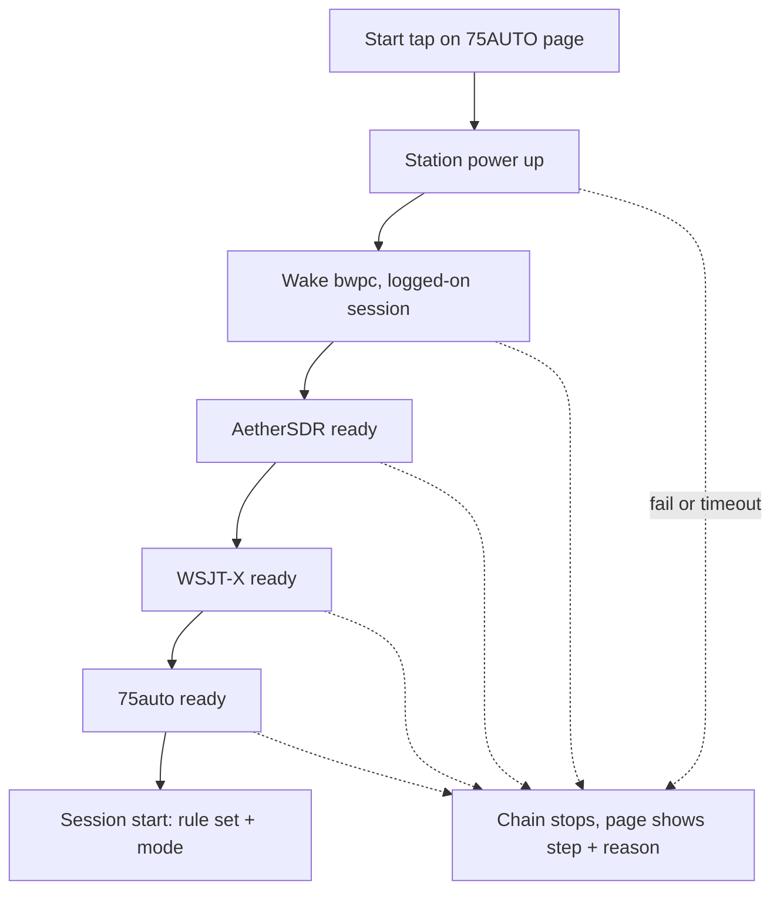
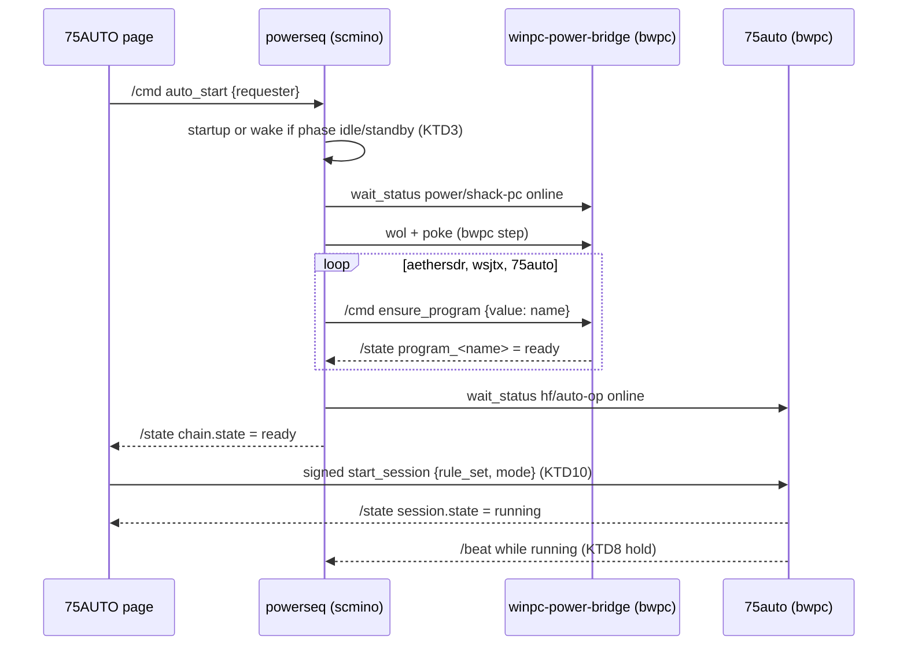
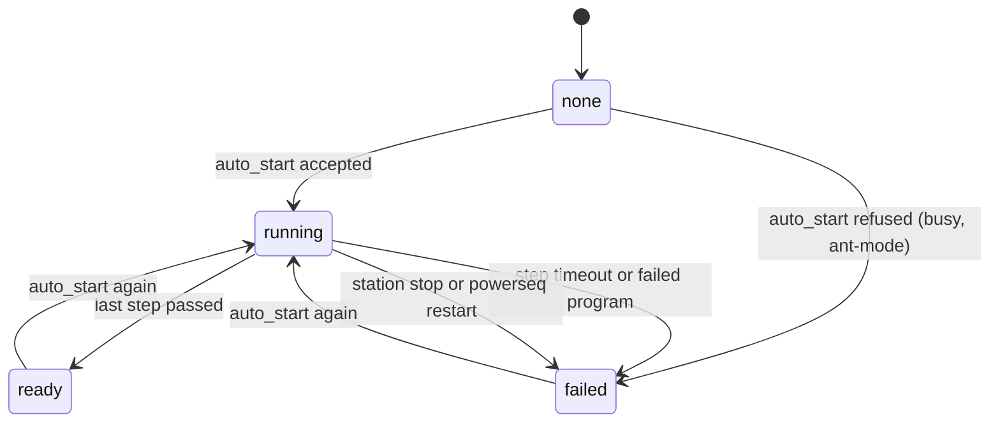
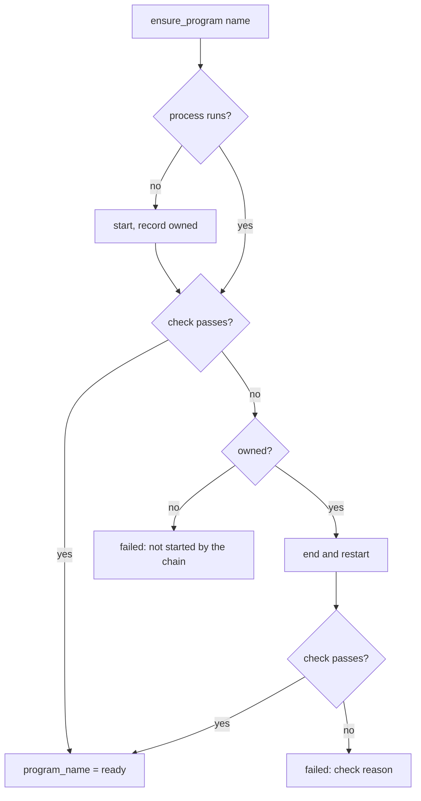

# 75auto Remote Start Chain - Plan

> Update 2026-11-27: DAX is dropped from the chain. WSJT-X on bwpc uses the AetherSDR TCI emulation (TCI server on 127.0.0.1:50001, TCI audio inside WSJT-X). The chain is now station, bwpc, aethersdr, wsjtx, 75auto. This update fixes the chain list, R3, R9, R23, the diagrams and the bench checks. The text elsewhere is history.

## Goal Capsule

- Objective: The operator, away from the shack, starts an FT8/FT4 session of 75auto from the 75AUTO page of hf_console with one tap, from any station power state. The page shows where the start stopped if it fails.
- Means: powerseq runs the start as an ordered sequence. A per-program actuator on bwpc starts AetherSDR, the patched WSJT-X and 75auto. 75auto gets a remote session start.
- Product authority: the operator (station owner). 75auto is a separate repo (github.com/kgbvax/75auto). Its changes land there, and the stationa changes land here.
- Open blockers: none.
- Execution profile: three merges, grouped below as PR1 to PR3. stationa has no CI, so a "PR" here is a branch merged to main. PR1 lands in the 75auto repo. PR3 ends with the bench check on bwpc.
- Stop conditions: stop and ask if the bench check shows that bwpc cannot be kept out of Modern Standby (KTD7), or that WSJT-X gets no TCI audio from AetherSDR without a SmartSDR window. Both break the chain.
- Who finishes: an implementing agent builds and tests all units. Deploys to scmino and bwpc and the bench check need the operator present, because a 75auto deploy ends a live session.

---

## Product Contract

### Summary

One Start tap on the 75AUTO page powers the station up, wakes bwpc, starts the four digimode programs in order, and then starts a 75auto session with the rule set and mode that the operator picked. powerseq owns the order and the ready checks. A thin actuator on bwpc does the local work behind a contract that a Linux host can implement later. A running session keeps the station powered.

### Problem Frame

A 75auto session starts only at the bwpc desk today. A person must log on to Windows, start AetherSDR for the rigctl emulation and the TCI audio, and the patched WSJT-X. Then the person picks a rule set and a mode in the start panel of the 75auto window. Nothing starts 75auto at logon, and its remote interface has no start command (75auto `docs/interfaces/auto-op-mqtt-api.md`, action table).

The 75AUTO page can watch, steer and stop a running session. It cannot begin one, so remote operation works only after somebody prepared bwpc locally. powerseq also does not see a 75auto session as activity, so its idle shutdown can power the station down under a running session.

### Key Decisions

- **The stack stays on bwpc now, and the contract is ready for a Linux move later.** The AetherSDR setup and the patched WSJT-X already work on Windows. A headless Linux stack is a separate, larger piece of work. Governs R9, R10. (session-settled: user-directed, chosen over "move to Linux headless now" and "automate on bwpc only": keep the working Windows stack but do not lock hf_console and powerseq to it.)
- **One tap runs the full chain.** The operator does not prepare bwpc before the tap. Governs R1, R3, R5. (session-settled: user-directed, chosen over "session start only" and "chain plus self-heal": the full chain is the smallest change that makes remote start work from cold, and self-heal is deferred.)
- **powerseq owns the order.** powerseq already has ordered steps, delays, liveness waits, a wake step and a hold. The bwpc actuator does no ordering. Governs R5, R6, R10. (session-settled: user-directed, chosen over "the bwpc agent owns the chain" and "75auto owns the chain": one sequencer for the station, and a Linux move replaces only the actuator.)
- **A running session holds the power.** Governs R15. (session-settled: user-directed, chosen over "close the chain at session end" and "no coupling": powerseq must not cut power under a session, and the programs stay up until the normal idle timers end them.)
- **bwpc logs on automatically and locks at once.** A cold boot or a power loss must not need a person at the desk. Governs R13. (session-settled: user-directed, chosen over "no auto-logon": with no auto-logon a reboot blocks remote start until somebody logs on locally.)
- **hf_console sends the signed session start.** hf_console is the entry point, so the command key stays on the operator device and powerseq needs no key. The cost is that the page must stay open until the chain is ready. Governs R1, R12a.
- **The chain adopts programs that already run.** An operator at the desk can start programs by hand, and the remote chain must not start a second copy or close their work. Governs R7, R8.

### Actors

- A1. Operator: uses the 75AUTO page on a phone, the tablet or the web channel, at the shack or away.
- A2. powerseq: the station sequencer on scmino.
- A3. bwpc actuator: starts, stops and checks the digimode programs in the logged-on session on bwpc.
- A4. 75auto: the automatic operator on bwpc, which takes the session start and enforces its gate.

### Requirements

**Start from the page**

- R1. hf_console is the entry point. The 75AUTO page gets its own Start control, next to the existing Start of the Station tab. The 75AUTO Start takes the station from any power state to a running 75auto session.
- R1a. The Start of the Station tab keeps its current behavior: it runs the powerseq station start and does not start the digimode programs or a session.
- R2. Before the tap, the operator picks a rule set and a mode (`observe`, `confirm` or `auto`) on the page. The page offers the last used values as the default.
- R3. During the start, the page shows the state of each step: station power, bwpc awake and logged on, AetherSDR, WSJT-X, 75auto and the session.
- R4. If a step fails or times out, the chain stops there, and the page shows the failed step with a reason. The operator can start again from the page.

**Sequencing**

- R5. powerseq runs the chain as one ordered sequence. Each step waits for a ready confirmation, with its own timeout.
- R6. Steps that are already done are skipped. For example, a station that is already powered up goes straight to the bwpc steps.

**Programs on bwpc**

- R7. If a program already runs, the chain uses it and does not start a second copy.
- R8. The chain never closes a program that it did not start.
- R9. The bwpc actuator starts and stops AetherSDR, the patched WSJT-X and 75auto, and reports ready for the first two. 75auto reports its own readiness on its slot. The actuator also reports whether a logged-on desktop session exists.
- R10. The actuator contract does not depend on Windows. A Linux agent on another host can implement it later, and powerseq and hf_console then need only configuration changes.
- R11. Ready means that the program can do its job, not only that its process exists. For example, the rigctl port answers, or WSJT-X sends its status.

**Session in 75auto**

- R12. 75auto accepts a remote session start with a rule set and a mode, and a remote session end. Both obey the same signature, time window and `operate` rule as the other remote commands. The gate keeps all its hard limits.
- R12a. The 75AUTO page sends the signed session start itself when powerseq reports the chain ready. The command key stays on the operator device. If the page closes before the chain is ready, the programs stay up and no session starts.

**bwpc logon**

- R13. bwpc logs on automatically at boot and locks the screen at once. The actuator and the programs run in that session.
- R14. A boot or a logon does not start the chain. Only a Start tap starts the chain.

**Power**

- R15. A 75auto session in the state `connecting` or `running` counts as activity for the idle standby and the idle shutdown of powerseq. When the session ends, the normal idle timers start again.
- R16. The session counts as activity only while 75auto still sends a fresh heartbeat. A crashed or frozen 75auto does not hold the power.
- R17. While a chain runs or a 75auto session is active, bwpc does not enter Modern Standby by itself. At other times bwpc sleeps as it does today.
- R22. While a 75auto session is active, antenna-select does not ground the antenna for lack of VFO or TX activity.

**Safety and stale programs**

- R18. If a program that the chain started itself fails its ready check, the chain restarts it. A program that the chain did not start is never restarted, and the chain stops at that step with a reason (per R8).
- R23. Each chain restarts the WSJT-X copy that the chain started itself, so they bind to the radio as it is now. Copies that the operator started are not restarted (per R8).
- R19. The 75AUTO Start is refused while the antenna mode is `storm` or `maintenance`.
- R20. A remote session start is refused while a session is open, also a latched one. After that session ends, a new remote start is allowed.

**PA during a session**

- R21. When a 75auto session starts, from the chain or from the bwpc window, the PA goes to standby once. The operator can then put the PA in operate by hand, and nothing switches it back to standby during that session.

### Key Flows

- F1. Remote start from cold
  - **Trigger:** The operator taps Start on the 75AUTO page.
  - **Actors:** A1, A2, A3, A4
  - **Steps:** The page asks powerseq for the chain. powerseq powers the station up if needed. powerseq wakes bwpc and waits for the actuator to report a logged-on session. powerseq starts AetherSDR, WSJT-X and 75auto in that order and waits for each ready. When powerseq reports the chain ready, the page sends the signed session start with the chosen rule set and mode.
  - **Outcome:** The page shows the session as `running`.
  - **Covered by:** R1, R2, R3, R5, R6, R9, R11, R12, R12a, R13

- F2. Session end and power-down
  - **Trigger:** The operator ends the session from the page, or 75auto ends it.
  - **Actors:** A1, A2, A4
  - **Steps:** The session state leaves `running`. powerseq no longer counts it as activity, and the idle timers start.
  - **Outcome:** Standby and shutdown follow the normal idle rules.
  - **Covered by:** R12, R15

### Acceptance Examples

- AE1. **Covers R1, R5, R6, R13.** Given that the station is powered down and bwpc is off after a power loss, when the operator taps Start, then bwpc boots, logs on, locks, the four programs come up in order, and the session runs.
- AE2. **Covers R7, R8.** Given that the operator started WSJT-X at the desk, when the chain reaches the WSJT-X step, then it uses the running WSJT-X. When the station later shuts down, the chain does not close that WSJT-X before the shutdown.
- AE3. **Covers R3, R4.** Given that another SmartSDR client holds the last GUI client slot of the FLEX-8400, when the AetherSDR step does not report ready in its timeout, then the chain stops, WSJT-X and 75auto do not start, and the page shows "AetherSDR" as the failed step.
- AE4. **Covers R15.** Given that a session ran for 3 h with no other station activity, then powerseq did not shut the station down. When the session ends, the 2 h idle shutdown timer starts from the end of the session.
- AE5. **Covers R14.** Given that Windows Update restarts bwpc, then bwpc logs on and locks, and no program of the chain starts until the next Start tap.
- AE6. **Covers R1a.** Given that the operator taps Start on the Station tab, then powerseq runs the station start only, and no digimode program and no session starts.
- AE7. **Covers R12.** Given that `remote.commands` is `stop` in the 75auto configuration, when the page sends a session start, then 75auto refuses it with the reason `stop only`, and the page shows that reason.
- AE8. **Covers R23.** Given that the chain started WSJT-X yesterday and the FLEX was power-cycled since, when the operator taps Start, then the chain ends and starts it again before its ready check, and the session gets audio.
- AE9. **Covers R19.** Given that antmode is in `storm`, when the operator taps the 75AUTO Start, then nothing starts and the page shows "antenna mode storm".
- AE10. **Covers R20.** Given that the operator tapped STOP TX and the latched session is still open, when the operator taps Start, then 75auto refuses with `busy`. When the operator first ends that session, the next Start begins a new session.
- AE11. **Covers R21.** Given that the PA is in operate, when a 75auto session goes to `connecting`, then the PA goes to standby. When the operator then sets the PA to operate on the console, the PA stays in operate until the session ends.

### Scope Boundaries

- The move of the stack to a headless Linux host is deferred. R10 only keeps that path open.
- A restart of a program that crashes or hangs during a session (self-heal) is deferred.
- The chain does not start automatically at boot or logon (R14).
- The chain does not close the programs at session end or at idle shutdown. Idle shutdown puts bwpc into standby, and the next chain finds the programs and applies R7 and R18.
- 75auto itself does not read the antenna mode. R19 is enforced by powerseq and the page only. A running session during a storm entry is an existing gap, outside this work.
- The broker accounts `auto-op` and `console` and the split bridge mapping stay separate work (`docs/known-issues.md`, "Remote TX review for 75auto").
- A rebuild of the tablet APK is not part of this work.

### Dependencies / Assumptions

- powerseq wakes bwpc from Modern Standby with a TCP connect (`wol` step with `poke`), because a magic packet does not wake it from that state (`winpc-power-bridge/CLAUDE.md`). Assumption, not verified: wake-on-LAN also wakes bwpc from a full shutdown.
- Assumption: AetherSDR gives WSJT-X the CAT and the audio that it needs over its TCI emulation, without a SmartSDR GUI client.
- The FLEX-8400 allows a limited number of GUI clients. AetherSDR uses one of them (see AE3).
- A remote session start in `auto` mode can begin transmitting with nobody at the station. The remote TX decision in `docs/known-issues.md` ("Remote TX review for 75auto", 2026-11-26) must cover the session start before this work goes live. The presence timer of the gate stays the dead-man rule.

### Sources / Research

- 75auto `docs/interfaces/auto-op-mqtt-api.md`: the remote command set, the time window and the `operate` rule.
- 75auto `internal/remote/command.go`: the action constants and the `stop only` gate.
- 75auto `scripts/deploy.sh`: today 75auto starts once through a temporary scheduled task in the logon session.
- `winpc-power-bridge/deploy.sh` and `winpc-power-bridge/CLAUDE.md`: the logon task in the interactive session, the `sleep` action and the Modern Standby wake behavior.
- `powerseq/internal/config/config.go` and `powerseq/config.example.toml`: the step kinds `cmd`, `wait_status`, `wait_state`, `delay` and `wol`, the `[[idle.watch]]` entries and the ant-mode hold.
- `docs/known-issues.md`, "[decision] Remote TX review for 75auto (auto-op)".

---

## Planning Contract

Product Contract preservation: changed. R15 split into R15 and R16, and R17 to R23 added, with no change to the earlier R-IDs. R21 (PA standby) was added by the operator during planning. The document review narrowed R17 to the chain and the session (a permanent power request would stop bwpc from ever sleeping), added R22 (antenna-select grounds a quiet session after 30 min) and R23 (owned WSJT-X restarted on each chain, chosen by the operator after the review), aligned R9 with the 75auto readiness check, and moved AetherSDR before the other programs in F1 and R3. The new rules come from the plan-time research (programs that outlive an idle shutdown, a frozen 75auto, Modern Standby under a locked screen, the antenna-mode lock, the stop latch) and were confirmed by the operator before this write.

### Key Technical Decisions

- KTD1. **winpc-power-bridge becomes the bwpc actuator.** It already runs at logon in the interactive desktop session (`winpc-power-bridge/deploy.sh`, task with `LogonType InteractiveToken`), so programs that it starts open on that desktop. Its `/status` `online` already means that a logged-on session exists, which covers the session part of R9. Governs R9, R13. (session-settled: user-approved, chosen over a new bwpc agent: a second logon agent would repeat the session, MQTT and deploy plumbing.)
- KTD2. **The chain is a new powerseq action `auto_start` with its own `chain` sub-state.** The station `phase` changes only through the startup or wake that the chain runs first. A failed chain step leaves `phase=running`, so standby and idle shutdown keep working. The fixed sequence lists in `powerseq/internal/config/config.go` get one more list, `[[auto_start]]`, validated like `[[standby]]`. Governs R4, R5, R6. (session-settled: user-approved, chosen over reusing `start`: `start` is refused in `running`, and a chain fault would set `phase=idle` on a running station.)
- KTD3. **Station phase decides what `auto_start` runs first.**
  1. `idle`: the startup list, then the chain.
  2. `standby`: the wake list, then the chain.
  3. `running`: the chain only. The chain list begins with the `wol` step with `poke`, because bwpc enters Modern Standby by itself after one hour while powerseq stays `running`. The step does nothing to an awake PC.
  4. `starting`, `waking`, `stopping`, `entering_standby`: refused with the reason `busy: <phase>`.
  5. A chain already runs: refused with `busy: chain running`, and `/state.chain` stays unchanged.
  6. A 75auto session is active: refused with `busy: session active`, because a program restart would break that session.

  The chain runs under its own context. The station `stop` cancels that context directly, not through the command queue, so the chain ends `failed` with `stopped by the operator` before the shutdown starts, and no `chain.state=ready` follows a stop. Governs R6.
- KTD4. **The actuator publishes one flat top-level `/state` field per program, `program_<name>`.** The values are `stopped`, `starting`, `ready` and `failed`, and a sibling `program_<name>_error` carries the reason. powerseq `wait_state` reads only top-level fields (`stateField`, `powerseq/internal/seq/seq.go`), so the chain steps are plain `cmd` plus `wait_state` steps. Two small `wait_state` options make this safe:
  - `fresh = true`: the step ignores a `/state` that arrived before the step started, so a retained `ready` from the last chain cannot pass it.
  - `fail_value = "failed"`: the step fails at once on that value, instead of after the timeout.

  A `wait_state` failure or timeout also adds the `<field>_error` sibling to the fault text, so the actuator's reason reaches `/state.chain.fault` and the page. The chain `cmd` steps to the actuator use `retain = false`, because winpc-power-bridge drops retained commands. Governs R4, R9, R11.
- KTD5. **`ensure_program` is one idempotent action.** It takes the program name under `value`.
  1. If the program runs and passes its check, the result is `ready`. This adopts a program that the operator started (R7). An owned program whose configuration sets `restart_owned = true` (WSJT-X) is ended and started again first (R23).
  2. If the program runs, fails its check and the actuator started it, the actuator ends it and starts it again (R18).
  3. If the program runs, fails its check and the actuator did not start it, the result is `failed`, with the reason `not started by the chain` (R8).
  4. If the program does not run, the actuator starts it and records it as owned.

  The actuator publishes `program_<name>=starting` as soon as it takes the command, in every branch. A program with check kind `none` (75auto) is started and recorded as owned, and its result is `ready` at once. The owned record (PID plus process start time) is saved in a file next to the agent configuration, so an agent restart keeps it. A PID whose start time does not match is not owned. The actuator starts programs outside its own Task Scheduler job, so a restart of the agent task does not end them. `stop_program` is refused while a 75auto session is active. Governs R7, R8, R18.
- KTD6. **Ready checks are of three kinds, set per program in the actuator configuration.** `process` means that the process stays up for `settle_s`. `tcp` means that a TCP connect to an address succeeds and a probe line gets a reply that matches a pattern. `none` means no check.
  - AetherSDR: `tcp` on its rigctl port (the station 75auto configuration uses `127.0.0.1:4532`), probe `f`, reply a number. A listener that answers `RPRT` with an error means that AetherSDR has no radio connection, for example because another client holds the last GUI client slot (AE3).
  - WSJT-X: `process`, because 75auto binds the WSJT-X UDP port 2237 at session start (75auto `internal/driver/wsjtx/transport.go`). The session reaching `running` is the real proof.
  - 75auto: `none`. The chain then waits with `wait_status` on `hf/auto-op`, because 75auto publishes its slot at program start, before any session (75auto `cmd/75auto/main.go`).

  Governs R11. (session-settled: user-approved, chosen over a WSJT-X UDP heartbeat check: it would conflict with the 75auto listener.)
- KTD7. **The actuator holds a Windows power request while a chain runs or a 75auto session is active.** It reads `chain.state` from `hf/power-seq` and the session state and beat from `hf/auto-op`, with the same freshness rule as KTD8. With owned programs still running and no chain or session, it releases the request, so bwpc can sleep. Whether the request keeps bwpc out of Modern Standby is checked on the bench (U6). Governs R17. (session-settled: user-approved, chosen over doing nothing: with the screen locked, Windows can enter Modern Standby during a session.)
- KTD8. **The session hold is a second hold source in powerseq, next to the antenna-mode `power_hold`.** It is active while the `hf/auto-op` `/state` has `session.state` `connecting` or `running`, and the last `/beat` or `/state` of `hf/auto-op` is younger than 30 s (75auto beats every 2 s during a session, per its contract). The hold is also active while `chain.state` is `running`, and for 30 min after it turns `ready` (the KTD10 window), so standby cannot fire under a start that the operator just asked for. An accepted `auto_start` counts as activity. When the hold ends, both idle clocks restart: the idle-shutdown clock like `holdEndedAt` for the antenna mode, and the standby baseline as if a watch had moved. `[[idle.watch]]` cannot express this, because it counts only changes. Governs R15, R16. (session-settled: user-approved, chosen over an idle watch on the session state: a session that stays `running` for hours would count as idle.)
- KTD9. **powerseq refuses `auto_start` while the antenna mode is `storm` or `maintenance`.** It reads the mode from the `hf/ant-mode` `/state` that it already subscribes. The page also disables its Start in those modes and checks again before it sends the session start. Governs R19. (session-settled: user-approved, chosen over no check: somebody can be at the mast in maintenance.)
- KTD10. **The requesting page sends the session start, within a time limit.** The `auto_start` command carries `{"requester": "<device id>"}` under `value`, and `/state.chain` echoes it. Only the page whose device id matches sends the signed `start_session`, and only within 30 min of its tap, which covers a cold start through a bwpc boot. It keeps that pending start in memory only, so an app restart drops it. Governs R1, R12a. (session-settled: user-approved, chosen over powerseq holding a command key: the key stays on the operator device.)
- KTD11. **`/state.chain` is the progress and feedback record.** Fields: `state` (`running`, `ready`, `failed`), `step`, `fault`, `requester`, `ts`. A refused `auto_start` writes `state=failed` with its reason, so the page always gets an answer. The page maps step names to its rows, so the `[[auto_start]]` step names are the row ids (`station`, `bwpc`, `aethersdr`, `wsjtx`, `75auto`). The page itself sets a last row, `session`, when it sends `start_session`, from the 75auto session state. A chain is not resumed after a powerseq restart. It is restored as `failed` with `interrupted by a powerseq restart`. Governs R3, R4.
- KTD12. **75auto gets `start_session` and `end_session` as remote actions.** `start_session` takes `{"rule_set", "mode"}` under `value` and calls the same `App.Start` path as the window, with `Source: live` and the stored level and globals, like `AutoStart`. `end_session` calls `App.End`. Both follow the `operate` rule and the time window of `internal/remote/command.go`. `start_session` refuses with `busy` while a session is open, latched or not (R20). A start in `auto` mode is allowed, which differs on purpose from `AutoStart`, which never starts in `auto`. The `docs/known-issues.md` decision record covers this. A remote start counts as presence for the gate. Governs R12, R20.
- KTD13. **75auto publishes its start options on `/state`.** A new `start` object carries the rule-set names from the `[rules]` folder and the stored last choice (rule set and mode). The page uses it for R2. Governs R2.

- KTD14. **powerseq sends the PA standby on the session start edge.** It already reads the `hf/auto-op` `/state` for KTD8. When `session.state` goes from not active to `connecting` or `running`, it sends `{"action":"set_mode","value":"standby"}` to `hf/pa` once for that session. It is edge-triggered, so a manual `operate` later in the same session is not overridden. A powerseq restart during a session re-baselines the edge from the retained `/state` and sends nothing. This covers sessions started at the desk too, which the chain never sees. Governs R21.
- KTD15. **75auto publishes a station hold for antenna-select.** While a session is `connecting` or `running`, 75auto adds `station_hold.hold_until` (now plus 10 min, refreshed with each beat) to its `/state`. antenna-select gets `auto-op` in `[idle].hold_slots`. This is the existing mechanism that bmrec's HF lab uses (`antennaselect/CLAUDE.md`, "Station holds"). Governs R22.
- KTD16. **The actuator commands stay unsigned, and the decision record says so.** `ensure_program` and `stop_program` on `power/shack-pc/cmd` need no signature, like `sleep`. A holder of the `hf` account or a client on the HA mirror can start the programs or end them outside a session. The worst case is a denial of service, because the program paths come only from the actuator configuration. `stop_program` is refused during a session (KTD5). A fake beat on `hf/auto-op` can keep the station powered (KTD8), which costs only power. U7 records both in the remote-TX decision.

### High-Level Technical Design

The happy path across the four actors:

The chain sub-state, independent of the station phase (KTD2, KTD11):

The decision of `ensure_program` (KTD5):

### Assumptions

- AetherSDR gives WSJT-X TCI audio and CAT on 127.0.0.1:50001 without a SmartSDR window, and it answers rigctl on its configured port. U6 checks both on bwpc.
- A Windows power request keeps bwpc out of Modern Standby while the screen is locked (KTD7). U6 checks it.
- The live 75auto configuration on bwpc has `[remote] commands = "operate"` and `[start] auto_start = false`. The `75auto-station` copy has no `[remote]` section, so the live file is authoritative.

### Deferred to Implementation

- The exact Windows API for the power request and for the process start time.
- The location and format of the owned-program file of the actuator.
- The default `settle_s` and step timeouts for each program, tuned on the bench.

---

## Implementation Units

### PR1: 75auto remote session start and end

Target repo: 75auto (`/Users/ingomar.otter/dev/75auto`, github.com/kgbvax/75auto). Paths in this group are relative to that repo.

Waits on: nothing for the build or the merge. The deploy to bwpc waits on U7 (the remote-TX decision record in PR2) being merged, because `start_session` makes a remote start in auto mode reachable.

### U1. Remote `start_session`, `end_session` and start options in 75auto

- **Goal:** 75auto starts and ends a live session on a signed remote command, and publishes the rule sets that the page can offer.
- **Requirements:** R2, R12, R20, R22, AE7, AE10. KTD12, KTD13, KTD15.
- **Dependencies:** none.
- **Files:**
  - `internal/remote/command.go`, `internal/remote/command_test.go`
  - `internal/app/remote.go`, `internal/app/remote_test.go`
  - `internal/remote/state.go`, `internal/remote/state_test.go`
  - `internal/app/app.go` (only if `Start` needs a helper for the stored level and globals)
  - `docs/interfaces/auto-op-mqtt-api.md`
- **Approach:**
  1. Add the two actions to the action constants, the whitelist in `run()` and the `do()` switch. Decode `{rule_set, mode}` under `value` for `start_session`.
  2. Extend the `Commander` interface and `app.Remote` with a start that builds a `StartRequest` the way `AutoStart` does, but keeps the requested mode, and with an end that calls `App.End`.
  3. Map `errSessionRun` to the existing `busy` reason, and an unknown rule set or mode to a refusal reason.
  4. Add the `start` object (rule-set names, last choice) to the remote `/state`.
  5. Add `station_hold.hold_until` to the remote `/state` while a session is `connecting` or `running` (KTD15).
  6. Update the action table, the refusal reasons and the `/state` field table in the contract document.
- **Patterns to follow:** the existing `arm_cq` and `band` actions in `internal/remote/command.go`, and `AutoStart` in `internal/app/settings.go`.
- **Test scenarios:**
  - `start_session` with a known rule set and `confirm`, signed, in the window, with `operate`, and no session: the session starts live with that rule set and mode.
  - `start_session` with mode `auto`: the session starts in `auto`.
  - `start_session` while a session runs: refused with `busy`, and the session does not change.
  - Covers AE10. `start_session` while a latched session is still open: refused with `busy`. After `end_session`, the next `start_session` starts a session.
  - `start_session` with a rule set that is not in the folder: refused, with no session.
  - `start_session` with `remote.commands = "stop"`: refused with `stop only` (AE7).
  - `start_session` with an expired `ts` or a bad signature: dropped like the other actions.
  - `end_session` with no session: refused with `no session`.
  - `/state` carries `start.rule_sets` from the folder and the stored last choice, and the payload stays inside its size limit.
  - During a running session, `/state.station_hold.hold_until` is about 10 min ahead and moves with the beat. After the session ends, the field is absent.
- **Verification:** the tests pass, and a signed test command starts a live session in the 75auto window on a development machine.

### PR2: bwpc actuator and powerseq chain

Waits on: nothing. It can be built in parallel with PR1.

### U2. Program actuator in winpc-power-bridge

- **Goal:** winpc-power-bridge starts, checks and restarts the digimode programs on bwpc and keeps bwpc awake while they run.
- **Requirements:** R7, R8, R9, R11, R17, R18, R23, AE2, AE3, AE8. KTD1, KTD4, KTD5, KTD6, KTD7, KTD16.
- **Dependencies:** none.
- **Files:**
  - `winpc-power-bridge/internal/config/config.go`, `winpc-power-bridge/internal/config/config_test.go` (new `[[program]]` list: name, exe, args, workdir, process name, check kind, check address, `settle_s`)
  - `winpc-power-bridge/internal/programs/manager.go`, `winpc-power-bridge/internal/programs/manager_test.go` (new: the KTD5 decision, the owned record)
  - `winpc-power-bridge/internal/programs/proc_windows.go`, `winpc-power-bridge/internal/programs/proc_other.go` (new: process list, start, end, start time, power request, behind build tags)
  - `winpc-power-bridge/internal/bridge/bridge.go`, `winpc-power-bridge/internal/bridge/bridge_test.go`
  - `winpc-power-bridge/cmd/winpc-power-bridge/main.go`
  - `winpc-power-bridge/config.example.toml`
  - `winpc-power-bridge/docs/winpc-power-bridge-mqtt-api.md`, `winpc-power-bridge/CLAUDE.md`
- **Approach:**
  1. Inject a process-control interface into the manager, as `IdleFunc` and `SuspendFunc` are injected today, so all decisions run in tests on macOS.
  2. Add the actions `ensure_program` and `stop_program` to the `HandleCommand` switch and to `/meta` capabilities. `stop_program` ends only an owned program.
  3. Run each `ensure_program` on the jobs worker, never on the paho handler. Publish `program_<name>=starting` first in every branch, then `ready` or `failed` with `program_<name>_error`.
  4. Re-check owned programs on the 30 s `/state` tick, so a program that dies later shows as `stopped`.
  5. Subscribe the `hf/power-seq` and `hf/auto-op` `/state` and the `hf/auto-op` `/beat`, and hold the power request per KTD7.
  6. Start programs outside the agent's job, so an agent restart leaves them running.
  7. Keep the existing `sleep` action and its guard unchanged.
- **Patterns to follow:** `internal/winpower` build tags and stubs, the `cmdErr` refusal pattern and `TestRetainedCmdIgnored` in `internal/bridge`.
- **Test scenarios:**
  - `ensure_program wsjtx` with WSJT-X not running: start is called, the record says owned, and `/state` goes `starting` then `ready` after `settle_s`.
  - Covers AE2. `ensure_program wsjtx` with a WSJT-X that the operator started and that passes its check: no start, `ready`, not owned.
  - Covers AE8. `ensure_program wsjtx` with an owned WSJT-X and `restart_owned = true`: end, start again, then `ready`.
  - `ensure_program wsjtx` with an operator-started WSJT-X and `restart_owned = true`: no restart, `ready` if the check passes.
  - An owned program without `restart_owned` that fails its check: end, start again, then `ready` (R18).
  - `ensure_program aethersdr` with a foreign AetherSDR whose rigctl port does not answer: `failed` with `not started by the chain`, and no end is called.
  - `tcp` check: a listener on the address gives `ready`, and a closed port gives `failed` after the timeout.
  - `stop_program` on a foreign program: refused, and the process stays up.
  - The agent restarts: an owned record whose PID and start time match is still owned, and a reused PID with another start time is not.
  - The power request is taken while `chain.state=running` or a session has fresh beats, and released when neither holds, with owned programs still running.
  - Covers AE3. AetherSDR's rigctl port accepts but answers `RPRT -1` to `f`: `failed` with the reply in `program_aethersdr_error`.
  - `ensure_program` on a program that is already `ready`: `/state` goes `starting`, then `ready`.
  - `ensure_program 75auto` (check `none`): started, owned, `ready` at once.
  - `stop_program wsjtx` while a session has fresh beats: refused, and the process stays up.
  - `ensure_program` with an unknown name: refused with a reason, and nothing starts.
  - A retained `ensure_program` command is dropped.
- **Verification:** the tests pass, the Windows cross-build and vet pass, and on bwpc an `ensure_program` from `mosquitto_pub` opens the program on the locked desktop.

### U3. powerseq `auto_start` chain and session hold

- **Goal:** powerseq runs the chain on request, reports its progress, refuses it in unsafe states, and holds the idle logic while a live session beats.
- **Requirements:** R3, R4, R5, R6, R15, R16, R19, R21, AE1, AE3, AE4, AE5, AE9, AE11. KTD2, KTD3, KTD8, KTD9, KTD10, KTD11, KTD14.
- **Dependencies:** none for the build. The chain is useful only with U2 deployed.
- **Files:**
  - `powerseq/internal/config/config.go`, `powerseq/internal/config/config_test.go` (`[[auto_start]]` list, `[mqtt] auto_op_slot`, beat age)
  - `powerseq/internal/seq/seq.go`, `powerseq/internal/seq/seq_test.go`
  - `powerseq/internal/seq/persist.go`, `powerseq/internal/seq/persist_test.go`
  - `powerseq/internal/mqtt/client.go` (parse `auto_start` with `value`, subscribe `hf/auto-op` `/state` and `/beat`)
  - `powerseq/config.example.toml`, `powerseq/migrate-config.sh` (migration 2)
  - `powerseq/docs/powerseq-mqtt-api.md`, `powerseq/CLAUDE.md`
- **Approach:**
  1. Add the `auto_start` request to `request()` and `begin()` with the KTD3 table and the KTD9 refusal, under the same double guard as `start`. Run the chain under its own cancellable context, and let `request("stop")` cancel it directly.
  2. Run the startup or wake list first when needed, then the `[[auto_start]]` list, and write `chain` instead of `phase=idle` on a chain fault.
  3. Add the session hold next to `powerHold` in `idleDecision`, with the chain window and the restart of both idle clocks at hold end (KTD8).
  4. Add the `fresh` and `fail_value` options to `wait_state`, and the `<field>_error` sibling to the observed text (KTD4).
  5. Persist `chain`, and restore a `running` chain as `failed` with the restart reason.
  6. Ship an example `[[auto_start]]` list: the `wol` step with `poke` (name `bwpc`), wait for `power/shack-pc` online, then for AetherSDR, WSJT-X and 75auto an `ensure_program` with `retain = false` plus a `wait_state` with `fresh` and `fail_value`, then `wait_status hf/auto-op`.
  7. Add the PA standby on the session start edge (KTD14) next to the session hold, with `hf/pa` as a configured slot.
  8. Add migration 2, which appends the example list and the slot keys to the live configuration. The migration must stay idempotent and pass `powerseq -check`.
- **Patterns to follow:** `SetAntMode`, `powerHold` and `holdEndedAt` in `seq.go`, the step validation of `[[standby]]` in `config.go`, and migration 1 in `migrate-config.sh`.
- **Test scenarios:**
  - Covers AE1. `auto_start` in `idle`: the startup list runs, then the chain list, and `chain.state` ends `ready` with `phase=running`.
  - `auto_start` in `standby`: the wake list runs, then the chain.
  - `auto_start` in `running` with all programs ready: every wait passes at once and `chain.state=ready`.
  - `auto_start` in `starting` or `stopping`: `chain.state=failed` with `busy: <phase>`, and nothing runs.
  - `auto_start` in `running` with `power/shack-pc` offline: the wol and the poke go out, then the `bwpc` step passes when the agent comes online.
  - `auto_start` while a 75auto session has fresh beats: refused with `busy: session active`.
  - A retained `program_dax=ready` from before the step: a `fresh` wait does not pass on it.
  - `program_aethersdr=failed` with `program_aethersdr_error="not started by the chain"`: the step fails at once, and `chain.fault` carries the reason.
  - Covers AE3. A chain step times out in `running`: `chain.state=failed` names the step, `phase` stays `running`, and standby can still start later.
  - Covers AE9. `auto_start` while ant-mode is `storm`: refused with the mode in the reason.
  - The station `stop` during a chain: the chain ends `failed` with `stopped by the operator` before the shutdown runs, and no `chain.state=ready` is published.
  - Idle conditions met while a chain runs, or within 30 min after `ready` with no session: no standby.
  - A session ends after 3 h: standby waits a full `timeout_minutes` from the session end.
  - Covers AE4. A session with fresh beats for 3 h: no standby and no idle shutdown. When the session ends, the idle-shutdown clock starts from that moment.
  - A session `running` with its last beat older than 30 s: the hold ends.
  - Covers AE11. `session.state` goes `not-started` to `connecting`: one `set_mode standby` to `hf/pa`. A later PA `operate` in the same session gets no second standby.
  - A new session after an `ended` one: a new standby is sent.
  - powerseq restarts while a session runs: no standby is sent on the restored state.
  - A powerseq restart during a chain: the chain is restored as `failed` with the restart reason, and no `/cmd` is sent.
  - Two `auto_start` commands in a row: the second is refused with `busy: chain running`, and `/state.chain` (state, step, requester) stays the first one.
  - The configuration check rejects an `[[auto_start]]` step with an unknown kind.
  - Migration 2 run twice gives the same file, and the result passes `powerseq -check`.
- **Verification:** the tests pass with `-race`, and the example configuration passes `powerseq -check`.

### U7. Remote-TX decision record for the remote start

- **Goal:** the station decision record covers the remote session start before it becomes reachable.
- **Requirements:** R12, R19, R20. KTD12, KTD16.
- **Dependencies:** none.
- **Files:** `docs/known-issues.md`
- **Approach:** extend "[decision] Remote TX review for 75auto (auto-op)" with the remote session start, its difference from the 75auto auto-start policy in `auto` mode, the antenna-mode refusal, the latch rule, the unsigned actuator commands and the fake-beat vector of KTD16.
- **Test expectation:** none, because this unit changes only a document.
- **Verification:** the record names each new remote path and the operator's acceptance of it.

### PR3: hf_console Start, docs and bwpc setup

Waits on: PR1 and PR2, merge order, and both deployed (75auto on bwpc, powerseq on scmino, winpc-power-bridge on bwpc) before this group merges. The page sends commands that only the deployed versions accept.

### U4. 75AUTO Start in hf_console

- **Goal:** the 75AUTO page has a Start with rule-set and mode pickers, a progress list per step, and the signed session start at the end of the chain.
- **Requirements:** R1, R1a, R2, R3, R4, R12a, R19, R20, AE3, AE6, AE9, AE10. KTD9, KTD10, KTD11, KTD13.
- **Dependencies:** U1 and U3 for the wire contract.
- **Files:**
  - `hf_console/lib/ui/auto/auto_start_panel.dart`, `hf_console/test/ui/auto/auto_start_panel_test.dart` (new)
  - `hf_console/lib/ui/auto/auto_page.dart`, `hf_console/lib/ui/auto/auto_controls.dart`, `hf_console/lib/ui/auto/auto_commands.dart`
  - `hf_console/lib/store/auto_op.dart`, `hf_console/test/store/auto_op_test.dart` (parse `start`, the two new actions)
  - `hf_console/lib/store/wiring.dart`, `hf_console/test/store/wiring_test.dart` (`auto_start` payload, `chain` parsing)
  - `hf_console/test/support/auto_op_fixtures.dart`
- **Approach:**
  1. Show the Start panel when no session is open. Hide it during a session, when the existing controls take over.
  2. The Start control publishes `auto_start` to `muehle/hf/power-seq/cmd`, outside the `autoGateOf` gate, because 75auto may be offline at that moment.
  3. Show one row per chain step from `/state.chain.step` and `fault`, using the KTD11 step names.
  4. When `chain.state` turns `ready` and this device is the requester within 30 min of its tap, send `start_session` through `AutoCommander`, under the existing gate and key.
  5. Disable the Start with the reason when the antenna mode is `storm` or `maintenance`, and check again before the session start.
  6. Leave the Station tab Start as it is (R1a).
- **Patterns to follow:** `power_panel.dart` for the power-seq command and phase display, and `AutoCommander.send` and the `last_cmd` tracking in `auto_commands.dart`.
- **Test scenarios:**
  - Start with rule set and mode picked: the panel publishes `auto_start` with this device's requester id, not retained.
  - The pickers default to the last choice from `/state.start`.
  - `chain.step=aethersdr` then `chain.state=failed`: the rows show earlier steps done, AetherSDR failed with the fault text, and later steps not started (AE3).
  - `chain.state=ready` with this device as requester: one signed `start_session` with the picked rule set and mode.
  - `chain.state=ready` with another requester: no `start_session` is sent, and the progress shows.
  - `chain.state=ready` 31 min after the tap: no `start_session`, and the page shows that the start expired.
  - After `start_session`, the `session` row follows the 75auto session state to `running`.
  - Covers AE9. Antenna mode `storm`: the Start is disabled with the mode as the reason.
  - Covers AE10. `start_session` refused with `busy`: the page shows the reason and offers the end of the open session.
  - Covers AE6. The Station tab Start still publishes only `start` to power-seq.
  - No stored command key: the Start is disabled with the existing key hint, because the chain cannot end in a session.
- **Verification:** the widget and store tests pass, `flutter analyze` is clean, and the web channel shows the panel against a live bus.

### U5. Inventory and the antenna-select hold

- **Goal:** the station records show the managed programs, and antenna-select honors the 75auto station hold.
- **Requirements:** R13, R22. KTD1, KTD15.
- **Dependencies:** U1, U2, U3.
- **Files:**
  - `stationportal/internal/inventory/inventory.toml` (bwpc role and software: AetherSDR, WSJT-X as managed by winpc-power-bridge; the winpc-power-bridge note)
  - `antennaselect/config.example.toml` (`auto-op` in the `[idle].hold_slots` example) and the live `/etc/antenna-select/config.toml` on scmino, which is device-owned and needs a manual edit at deploy
  - `CLAUDE.md` (the rows of `powerseq`, `winpc-power-bridge` and `muehle/power/shack-pc`)
- **Approach:** no new slot is added, so `hf_console/lib/store/station_hosts.dart` does not change. The live antenna-select change waits until 75auto with KTD15 runs on bwpc.
- **Test expectation:** the stationportal inventory test and `hf_console/test/store/station_hosts_test.dart` still pass. The antenna-select hold uses existing code and needs no new test.
- **Verification:** the portal at `http://scmino/` lists the managed programs after the redeploy.

### U6. bwpc host setup and bench check

- **Goal:** bwpc logs on and locks by itself, and the external assumptions hold on the real machine.
- **Requirements:** R13, R14, R17, AE1, AE5.
- **Dependencies:** U2 deployed on bwpc, and U3 deployed on scmino.
- **Files:**
  - `winpc-power-bridge/docs/bwpc-host-setup.md` (new runbook: auto-logon with Sysinternals Autologon, a lock at logon, the program paths of the `[[program]]` list, wake-on-LAN in firmware)
  - `winpc-power-bridge/README.md` (a link to the runbook)
- **Approach:** the operator runs the setup steps, because they need the Windows password. The agent never handles the password (it uses Autologon, which stores it as an LSA secret).
- **Execution note:** this unit is setup and a bench check, so prove it with a runtime smoke check, not unit tests.
- **Test expectation:** none, because the unit changes no code. The bench checks below are its proof.
- **Verification:**
  1. A reboot of bwpc ends at a locked desktop with winpc-power-bridge online, and no chain program running (AE5).
  2. With AetherSDR started first and no SmartSDR window, `ensure_program` for WSJT-X gives TCI audio in WSJT-X without manual action.
  3. AetherSDR answers rigctl `f` with a frequency, and WSJT-X CAT works through it. With another client in the last GUI client slot, the probe fails.
  4. During a session with the screen locked, bwpc stays out of Modern Standby for 90 min. After the session ends, bwpc sleeps again.
  5. A restart of the winpc-power-bridge task leaves the owned programs running.
  6. With a chain-owned WSJT-X running, a power cycle of the FLEX, then a Start: WSJT-X restarts, and it gets TCI audio again (AE8).
  7. A 45 min `observe` session keeps the antenna connected (R22).
  8. A shut-down bwpc wakes from the `pc-boot` step (wake-on-LAN). If it does not, record the gap in `docs/known-issues.md`.
  9. A full 75AUTO Start from a cold station ends in a running session (AE1), and the PA is in standby (AE11).

### Deferred / Open Questions

**From the 2026-11-27 review**

- Which `session.state` a latched session reports (deferred to implementation). R20 and KTD8 assume that a latched session stays `running`. Confirm this in 75auto `internal/app` during U1.

---

## Verification Contract

| Scope | Command or check | Applies to |
|---|---|---|
| 75auto | `cd frontend && npm ci && npm run build` once (the Go binary embeds the page), then `go test ./... -race` and `CGO_ENABLED=0 go test $(go list ./... \| grep -v -e /internal/desktop -e /cmd/75auto)` | U1 |
| winpc-power-bridge | `go test ./...`, `GOOS=windows GOARCH=amd64 go build ./...`, `GOOS=windows go vet ./...` | U2 |
| powerseq | `go test ./... -race`, `go vet ./...`, `./powerseq -check -config config.example.toml` | U3 |
| hf_console | `flutter test`, `flutter analyze` | U4, U5 |
| stationportal | `go test ./...` | U5 |
| Whole Go workspace | `go build $(go list -m -f '{{.Dir}}/...')` at the repo root | U2, U3, U5 |
| bwpc bench | the nine checks of U6 | U6 |

---

## Definition of Done

- Every unit's tests and the commands of the Verification Contract pass.
- The bench checks of U6 pass on bwpc, or each failure is recorded in `docs/known-issues.md` with the operator's decision.
- The contract documents (75auto `docs/interfaces/auto-op-mqtt-api.md`, `powerseq/docs/powerseq-mqtt-api.md`, `winpc-power-bridge/docs/winpc-power-bridge-mqtt-api.md`) describe the new actions and fields.
- The inventory, the antenna-select hold and the remote-TX decision record are updated (U5, U7).
- No code from abandoned attempts is left in the diff.
